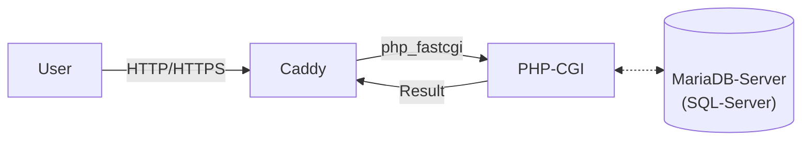

# WCMP (Windows Caddy MariaDB PHP)[^wcmp_notice]

Tool for setting up a Caddy server with PHP and MariaDB support on Windows.

## Warning

*WCMP is still in active development*

Please note that WCMP was designed for development purposes. You could try to use it in production.

If you find any bugs or have any suggestions, please open an issue at [issues](https://github.com/Hope-IT-Works/WCMP/issues/new/choose).

## About

After some research, I realized that there was no way to set up a Caddy server with PHP support without much effort. That''s why I created this repository. Later MariaDB server support was integrated too.



The script is pretty advanced and tries to do everything automatically. If it fails at any point, it will tell you what happened.

WCMP comes with default configuration files for all components. You can change them later if you want.

## Installation

> **Prerequisites:** PowerShell, 64-bit Windows, internet access.  
> Administrator rights are only required if you include Windows Services (default).

```powershell
& $([ScriptBlock]::Create((Invoke-WebRequest -UseBasicParsing -Uri "https://raw.githubusercontent.com/Hope-IT-Works/WCMP/main/src/Invoke-WCMPSetup.ps1").Content)) -Path "C:\ProgramData\WCMP"
```

The script always fetches the latest versions of all components and lets you choose from available PHP versions.

### Installation Parameters

| Parameter | Type | Default | Description |
|-----------|------|---------|-------------|
| `-Path` | `string` | current directory | Installation directory |
| `-Headless` | `switch` | off | Non-interactive mode - skips all prompts |
| `-Force` | `switch` | off | In headless mode: continue past warnings instead of aborting |
| `-SkipWinSW` | `switch` | off | Skip Windows Service installation (portable mode) |
| `-SkipPHP` | `switch` | off | Skip PHP installation |
| `-SkipMariaDB` | `switch` | off | Skip MariaDB installation |
| `-PHPPort` | `int` | `9000` | Port for PHP-CGI |
| `-MariaDBPort` | `int` | `3306` | Port for MariaDB |

### Examples

```powershell
# Standard installation with Windows Services
.\Invoke-WCMPSetup.ps1 -Path "C:\ProgramData\WCMP"

# Portable installation without Windows Services (uses Start-WCMP.bat / Stop-WCMP.bat)
.\Invoke-WCMPSetup.ps1 -Path "C:\WCMP" -SkipWinSW

# Installation with custom ports
.\Invoke-WCMPSetup.ps1 -Path "C:\WCMP" -PHPPort 9001 -MariaDBPort 3307

# Silent installation (no prompts, abort on warnings)
.\Invoke-WCMPSetup.ps1 -Path "C:\WCMP" -Headless

# Silent installation (no prompts, continue past warnings)
.\Invoke-WCMPSetup.ps1 -Path "C:\WCMP" -Headless -Force

# Installation without MariaDB
.\Invoke-WCMPSetup.ps1 -Path "C:\WCMP" -SkipMariaDB
```

## Running WCMP

### With Windows Services (default)

Services are installed to start automatically with Windows. You can manage them manually:

```powershell
Start-Service WCMP_Caddy, WCMP_PHP, WCMP_MariaDB
Stop-Service  WCMP_Caddy, WCMP_PHP, WCMP_MariaDB
```

### Without Windows Services (portable)

When installed with `-SkipWinSW`, two batch files are created in the installation directory:

```
Start-WCMP.bat   - starts Caddy, PHP-CGI and MariaDB in separate console windows
Stop-WCMP.bat    - stops all three processes
```

Double-click or run from the command line:

```cmd
C:\WCMP\Start-WCMP.bat
C:\WCMP\Stop-WCMP.bat
```

## Updating

The `-Update` parameter downloads and replaces the latest binaries of all installed components without touching configuration files or the MariaDB data directory.

```powershell
.\Invoke-WCMPSetup.ps1 -Update -Path "C:\ProgramData\WCMP"
```

If Windows Services are detected, they are stopped before and restarted after the update automatically (requires Administrator).

If WinSW was **not** installed initially but `-SkipWinSW` is omitted during update, the services are registered automatically.

### Update Parameters

| Parameter | Description |
|-----------|-------------|
| `-Update` | Enable update mode |
| `-Path` | Path to existing installation |
| `-SkipPHP` | Skip updating PHP |
| `-SkipMariaDB` | Skip updating MariaDB |
| `-SkipWinSW` | Skip updating WinSW |

> Ports are **not** changed during `-Update`. Use `-Reconfigure` to change ports.

## Reconfiguring Ports

To change ports after installation without reinstalling:

```powershell
.\Invoke-WCMPSetup.ps1 -Reconfigure -Path "C:\ProgramData\WCMP" -PHPPort 9001 -MariaDBPort 3307
```

> **Warning:** `-Reconfigure` patches configuration files using pattern matching. If you have manually customized any of the files below (e.g. added multiple `php_fastcgi` entries in the Caddyfile or changed the MariaDB config), those changes may be overwritten or produce unexpected results. Back up your configs before running `-Reconfigure`.

This patches all affected configuration files in-place:

| File | What is changed |
|------|----------------|
| `caddy\Caddyfile` | `php_fastcgi` port |
| `php\winsw_php.xml` | `-b` argument |
| `mariadb\bin\winsw_mariadb.xml` | `--port` argument |
| `Start-WCMP.bat` | both ports |

If Windows Services are installed, they are restarted automatically (requires Administrator).

### Reconfigure Parameters

| Parameter | Description |
|-----------|-------------|
| `-Reconfigure` | Enable reconfigure mode |
| `-Path` | Path to existing installation |
| `-PHPPort` | New PHP-CGI port |
| `-MariaDBPort` | New MariaDB port |
| `-SkipPHP` | Skip patching PHP configs |
| `-SkipMariaDB` | Skip patching MariaDB configs |

## Parameter Compatibility

Some parameters are mutually exclusive or have no effect in combination:

| Combination | Result |
|-------------|--------|
| `-Update` + `-Reconfigure` | Error - use one at a time |
| `-Force` without `-Headless` | Warning - `-Force` has no effect |
| `-PHPPort`/`-MariaDBPort` + `-Update` | Warning - ports are ignored during update |

## Documentation

| Service | Documentation | Default Ports |
|---------|---------------|---------------|
| Caddy | [caddyserver.com/docs](https://caddyserver.com/docs/command-line) | `80` HTTP · `443` HTTPS · `2019` Config-API |
| MariaDB | [mariadb.com/kb](https://mariadb.com/kb/en/documentation/) | `3306` SQL |
| PHP | [php.net/manual](https://www.php.net/manual/en/features.commandline.options.php) | `9000` PHP-CGI |

## FAQ

<details><summary>Is it portable?</summary>
<p>
       Use <code>-SkipWinSW</code> during setup for a portable installation. Start and stop WCMP using <code>Start-WCMP.bat</code> and <code>Stop-WCMP.bat</code> in the installation directory.
</p>
</details>

<details><summary>Why MariaDB?</summary>
<p>
       MariaDB is an open-source fork of MySQL. MariaDB provides better performance and more features than MySQL.<br>
       <a href="https://www.guru99.com/mariadb-vs-mysql.html">More information on this topic</a>
</p>
</details>

<!--
<details><summary></summary>
<p>
       
</p>
</details>
-->

[^wcmp_notice]: e.g. LAMP (Linux Apache MySQL PHP)